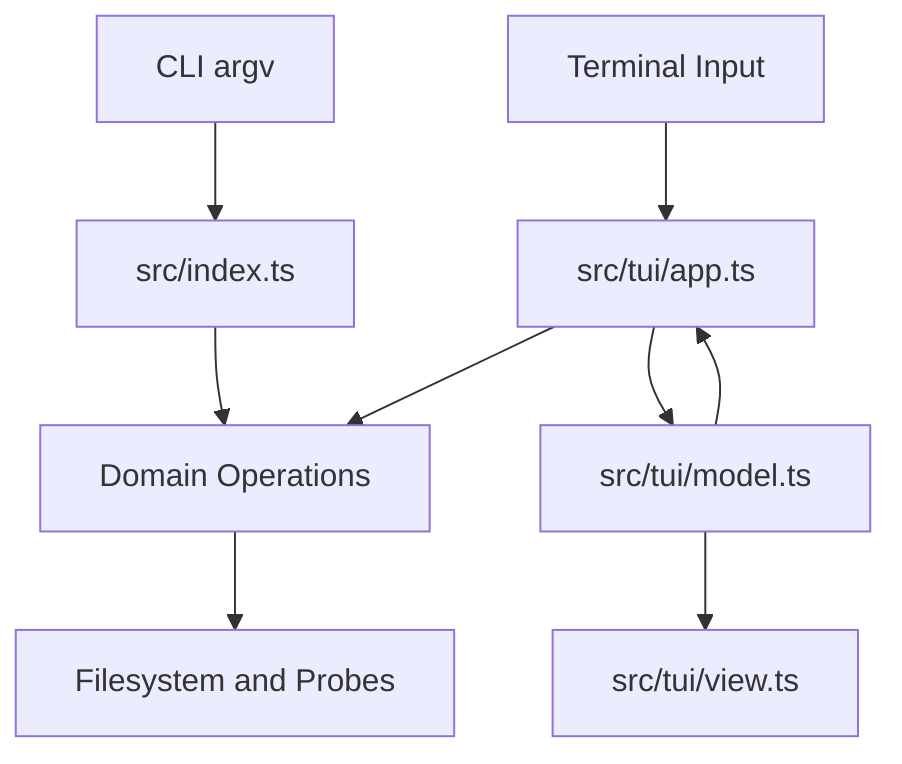

# Coding principles — cac

This document captures enforceable rules for the `cac` codebase.
Every coding agent must follow these principles when writing code.

---

## Language rule

- All code, comments, docs, exception strings, and commit messages must be in English.

---

## The red thread — request flow architecture

Every feature follows one of two execution paths.
Do not invent alternative flows.

| Concern | Path | Role | Contract |
|---|---|---|---|
| CLI Dispatcher | `src/index.ts` | Argument parsing and command routing | Parse argv, dispatch commands, exit with status code |
| TUI Runtime | `src/tui/app.ts` | Terminal raw-mode driver | Handle input, invoke reducer, trigger effects, write stdout |
| TUI State & Reducer | `src/tui/model.ts` | Pure state transition | Pure `applyEvent(state, event)` returning `{ state, effects }` |
| TUI View | `src/tui/view.ts` | Screen rendering | Pure `renderFrame(state, width, height)` returning `string[]` |
| Artifact Scanner | `src/scanner.ts` | Agent artifact inventory | Discover paths, measure sizes, classify safety tier |
| Artifact Cleaner | `src/cleaner.ts` | Artifact removal | Filter safe targets, guard protected files, run deletion |
| Project Scanner | `src/projects.ts` | Project session attribution | Match path slugs to session files and local agent configs |
| Skill Manager | `src/skills.ts` | Skill inspection and toggles | Check frontmatter, rewrite configs, move filesystem stashes |
| MCP Inspector | `src/mcp.ts` | MCP server discovery and health | Parse configs, run JSON-RPC probe, enforce timeouts |
| Domain Types | `src/types.ts` | Shared models and unions | Define domain interfaces, agent names, and safety levels |

### Red thread rules

- Parse CLI flags and commands in `src/index.ts`.
- Dispatch CLI commands directly to domain modules.
- Keep `src/tui/model.ts` free of side effects and I/O.
- Keep `src/tui/view.ts` free of state mutation and I/O.
- Run async tasks through effects returned by `applyEvent` in `src/tui/app.ts`.

---

## Hard limits

| Rule | Limit | Enforcement |
|---|---|---|
| Runtime dependencies | 0 external packages | Bun runtime and Node standard library only |
| Reducer side effects | 0 side effects | `applyEvent` must be a pure function |
| View side effects | 0 side effects | `renderFrame` must be a pure function |
| Deletion scope | Allowed roots only | Must reside inside home directory or project root |
| Protected files | 0 deletions | Must never delete SQLite sidecars or lock files |

---

## Deletion safety rules

- Target paths must sit at least one segment below allowed roots.
- Allowed roots are the user home directory and the project directory.
- Never delete SQLite sidecar files (`.db-wal`, `.db-shm`, `.sqlite-wal`, `.sqlite-shm`).
- Never delete `.lock` files.
- Never delete artifacts in the `critical` safety tier.
- Artifacts in the `caution` safety tier require explicit operator approval.
- Never follow symlinks when removing files or directories.
- Unlink symlinks directly so targets remain untouched.

---

## Naming conventions

| Construct | Convention | Example |
|---|---|---|
| Types and Interfaces | `PascalCase` | `ArtifactRecord`, `SkillRecord`, `SafetyLevel` |
| Functions | `camelCase` | `scanArtifacts`, `cleanArtifacts`, `isSafeTarget` |
| Variables | `camelCase` | `records`, `safetyLevels`, `dryRun` |
| Constants | `UPPER_SNAKE_CASE` | `AGENTS`, `CATEGORIES`, `PROTECTED_SUFFIXES` |
| Source Files | `kebab-case` or `camelCase` | `cleaner.ts`, `projects.ts`, `app.ts` |
| Test Files | `*.test.ts` | `safety.test.ts`, `projects.test.ts` |

---

## Design principles

- **Guard clauses**: check preconditions at the top of functions.
- **Fail fast**: reject invalid inputs before running operations.
- **Pure functions**: return new objects or arrays instead of mutating inputs.
- **Strict typing**: use explicit TypeScript types and avoid `any`.

---

## Error handling

- Check file existence and access before reading or writing.
- Non-fatal operations return structured result objects with error fields.
- Throw descriptive errors at system boundaries.
- Exit with status code `1` when checks report errors or servers are unavailable.

---

## Testing

- Write tests with `bun:test` (`describe`, `test`, `expect`).
- Structure tests using the Arrange-Act-Assert (AAA) pattern.
- Clean up temporary files in `afterAll` or `afterEach` hooks.
- Name tests with the scenario and expected outcome.

---

## What NOT to do

- Do not add external npm packages to `package.json`.
- Do not perform I/O inside `src/tui/model.ts` or `src/tui/view.ts`.
- Do not bypass `isSafeTarget` or `isProtected` checks in deletion logic.
- Do not clean `critical` tier artifacts.
- Do not clean `caution` tier artifacts without operator opt-in.
- Do not follow symlinks during removal operations.
- Do not use non-English text anywhere in the repository.

---

## Build facts to preserve

- Target runtime is Bun.
- TypeScript compiler options: `verbatimModuleSyntax: true` and `strict: true`.
- Type check command: `bun run typecheck`.
- Test command: `bun test`.
- Binary compilation command: `bun run build:exe`.
